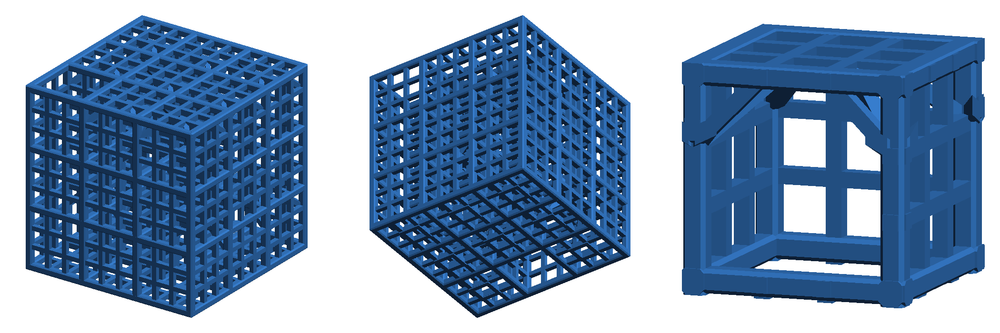

# Maze³

Klasyczny labirynt, uogólniony na trzy wymiary: sześcienne komórki,
przejścia we wszystkich sześciu kierunkach, żadnej wyróżnionej osi.
Kostkę obraca się na wszystkie strony, prowadząc w środku kulkę.

Taka przestrzeń otwiera możliwości, których płaski labirynt nie ma — na
przykład droga przez labirynt może zawiązać się w węzeł. W labiryncie
`lab4_1` droga od wejścia do wyjścia, domknięta na zewnątrz kostki, tworzy
trójlistnik.


## Zawartość

| Ścieżka | Co to jest |
|---|---|
| `maze_cubed.py` | generator labiryntu (STL + 3MF) |
| `ball.py` | piłka do labiryntu: dwudziestościan ścięty |
| `mazes/` | układy labiryntów (pliki ze ścieżkami) |
| `models/` | gotowe modele do druku |
| `tools/knot.py` | typ węzła drogi przez labirynt |
| `tools/random_maze.py` | losowy labirynt w formacie pliku ze ścieżkami |
| `tools/preview.py`, `tools/render.py` | podglądy PNG |
| `images/` | podglądy |

## Użycie

```sh
pip install -r requirements.txt

python maze_cubed.py mazes/lab4_1.txt     # labirynt → models/lab4_1.stl, .3mf
python maze_cubed.py --size 4 4 4         # pełna kratownica bez przejść
python maze_cubed.py mazes/lab3_1.txt --rod 2.4 --muntin 1.6 --chamfer 0.4   # grubsza konstrukcja
python ball.py                            # piłka 10 mm → models/ball_10mm.stl, .3mf
python tools/knot.py mazes/lab4_1.txt     # typ węzła drogi
python tools/random_maze.py --size 3 3 3 --seed 1 --knot unknot -o mazes/lab3_1.txt
python tools/random_maze.py --size 3 4 5 --seed 1 --tries 300 --knot knotted -o mazes/lab345_1.txt
```

Generator sprawdza też sam labirynt: czy obejmuje wszystkie komórki, czy
jest spójny i bez pętli i ile ma wyjść na zewnątrz.

## Labirynty

| Plik | Rozmiar | Droga | Odgałęzienia | Węzeł | Uwagi |
|---|---|---|---|---|---|
| `lab3_1` | 3×3×3, 62 mm, ~19 g | 14 z 27 komórek | 5 | brak | rozgrzewka, wydruk próbny |
| `lab4_1` | 4×4×4, 82 mm, ~41 g | 39 z 64 komórek | 9 | trójlistnik | główne wyzwanie |
| `lab345_1` | 3×4×5, 62×82×102 mm, ~39 g | 39 z 60 komórek | 9 | trójlistnik | różne boki ułatwiają orientację |


`lab3_1` jest wylosowany przez `tools/random_maze.py` (ziarno 1): droga
idzie we wszystkich sześciu kierunkach, wejście jest od spodu, a wyjście
na górze.


`lab345_1` też jest wylosowany (ziarno 1, `--knot knotted`). Wejście
i wyjście są na przeciwległych wąskich ściankach (3×5 komórek). Losowe
drzewo prawie nigdy nie zawiązuje drogi, więc w tym trybie generator
najpierw losuje silnie splątaną ścieżkę Hamiltona, wycina z niej
zawiązany odcinek i dopiero z niego wyprowadza resztę labiryntu.
Ósemka (`--det 5`) przy tym rozmiarze praktycznie się nie trafia.

## Format pliku ze ścieżkami

Lista ścieżek, każda jako lista kolejnych komórek `[x, y, z]`. Komórki
wewnątrz mają współrzędne od 1 do N; 0 albo N+1 oznacza wyjście na
zewnątrz. Między dwiema kolejnymi komórkami ścieżki ścianka jest otwarta.
Odgałęzienia zapisuje się jako osobne ścieżki, zaczynające się w komórce
już odwiedzonej.

```js
pass4x = [
	[ [2, 3, 0], [2, 3, 1], [2, 4, 1], /* … */ [3, 3, 5] ],
	[ [2, 4, 2], [3, 4, 2], [3, 4, 1], [3, 3, 1] ],
	/* … */
];
```

Rozmiar kratownicy jest odgadywany ze ścieżek; można go też podać jawnie:
`--size NX NY NZ`.

## Konstrukcja


- **Kratownica:** pręty 2 × 2 mm z fazką 0,5 mm, rozstaw osi 20 mm.
  Labirynt 4×4×4 ma 82 mm boku.
- **Ścianki:** kratka szprosów 1 × 1 mm dzieląca każde okno na 3 × 3
  okienka (5,33 mm), wyśrodkowana w płaszczyźnie prętów. Na przejściach
  szprosów nie ma.
- **Wsporniki sufitu:** 4 w każdej komórce, w rzucie po przekątnej, od
  skrzyżowań szprosów sufitu do narożnych prętów pionowych, zaczepione na
  wysokości górnej linii szprosów. Znikają tylko razem z sufitem.
- **Zastrzały:** nad każdą otwartą ścianką boczną dwa zastrzały 45°
  podpierają górny pręt, na tej samej wysokości co wsporniki.
- **Podpórki:** pod każdą poziomą ścianką ramka środkowego okienka sięga
  w dół do poziomu spodu prętów, czyli wystaje pod szprosy o grubość
  fazki. Na dolnej ściance kostki opiera się o stół.

Wymiary są parametrami na początku `maze_cubed.py`; pręt, fazkę, szpros
i bok komórki można też podać w wierszu poleceń (`--rod`, `--chamfer`,
`--muntin`, `--edge`), a nazwa pliku wynikowego dostaje wtedy przyrostek,
np. `lab3_1_rod2.4_chamfer0.4_muntin1.6`. Szpros nie może być szerszy
niż płaska część pręta (pręt − 2 × fazka).

Wariant próbny `lab3_1_rod2.4_chamfer0.4_muntin1.6` — wymiary dobrane do
dyszy 0,4 mm (pręt 6 linii, szpros 4 linie): 62,4 mm, ok. 36 g PLA,
okienka 4,8 mm, otwory boczne przepuszczają do ok. 17 mm.



Elementy, które się stykają, różnią się grubością o kilka do kilkudziesięciu
mikrometrów (`EPS`), żeby żadne ich ścianki nie leżały w jednej płaszczyźnie
ani na krawędzi innego elementu — dzięki temu siatka jest szczelna i bez
zdublowanych wierzchołków przy dowolnych wymiarach.

## Druk

Model drukuje się bez podpór, w orientacji z pliku. Najdłuższe mosty mają
ok. 5,3 mm. Wsporniki sufitu są nachylone ok. 35° od poziomu — przy dobrym
chłodzeniu wychodzą, ale ich spód może być mniej równy.

## Piłka


Dwudziestościan ścięty o średnicy 10 mm (krawędź 2 mm), do druku na
sześciokątnej ściance. Rozsądny zakres to 8–10 mm: mniejsza kulka klinuje
się w okienkach podłogi, a otwory ze zastrzałami przepuszczają ok. 17 mm.
Średnicę zmienia `--diameter`.
