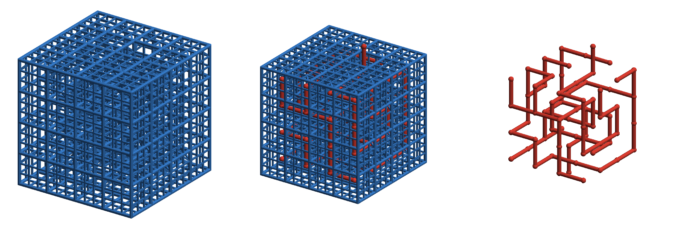
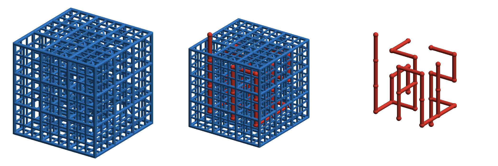
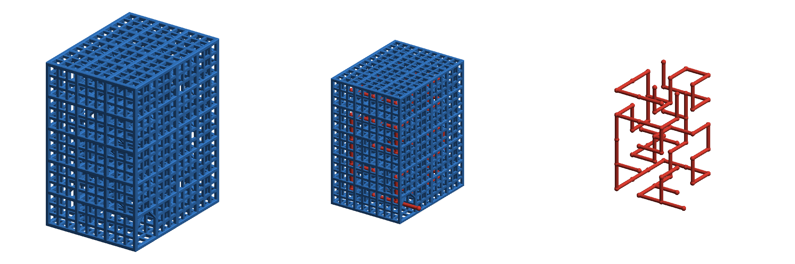
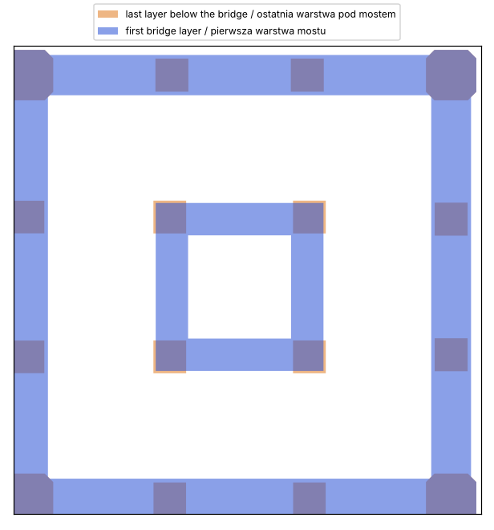
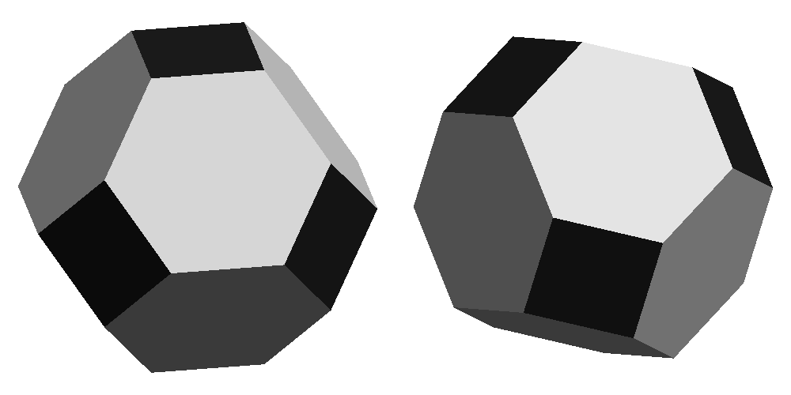
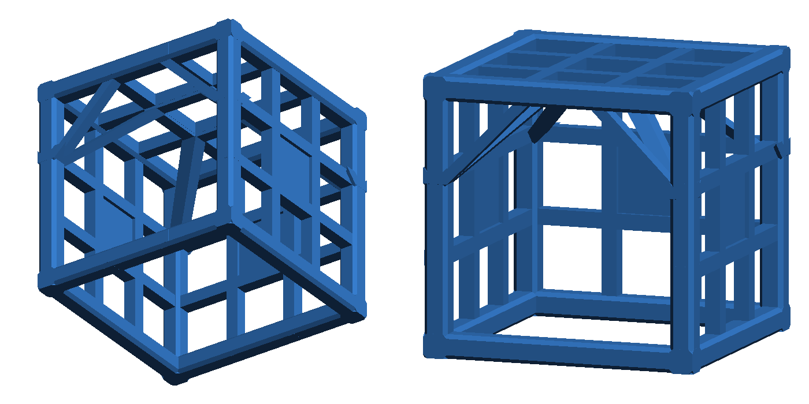

# Maze³

[English](README.md) · **Polski**

Klasyczny labirynt uogólniony na trzy wymiary: sześcienne komórki,
przejścia we wszystkich sześciu kierunkach, żadnej wyróżnionej osi.
W środku toczy się kulka, a kostkę obraca się na wszystkie strony, żeby
doprowadzić ją od wejścia do wyjścia.

Taka przestrzeń otwiera możliwości, których płaski labirynt nie ma — na
przykład droga przez labirynt może zawiązać się w węzeł. W labiryncie
`lab4_1` droga od wejścia do wyjścia, domknięta na zewnątrz kostki, tworzy
trójlistnik.



## Labirynty

| Plik | Rozmiar | Droga | Odgałęzienia | Węzeł | Uwagi |
|---|---|---|---|---|---|
| `lab2_1` | 2×2×2, 42 mm, ~13 g | 8 z 8 komórek | 0 | — | tylko do testów druku |
| `lab3_1` | 3×3×3, 62 mm, ~35 g | 14 z 27 komórek | 5 | — | rozgrzewka |
| `lab334_1` | 3×3×4, 62×62×82 mm, ~46 g | 19 z 36 komórek | 6 | — | krok wyżej |
| `lab344_1` | 3×4×4, 62×82×82 mm, ~60 g | 21 z 48 komórek | 8 | — | długie ślepe zaułki |
| `lab4_1` | 4×4×4, 82 mm, ~77 g | 39 z 64 komórek | 9 | trójlistnik | główne wyzwanie |
| `lab345_1` | 3×4×5, 62×82×102 mm, ~73 g | 39 z 60 komórek | 9 | trójlistnik | różne boki ułatwiają orientację |

Masy dla PLA. Każdy labirynt jest *doskonały*: każda komórka jest
osiągalna, nie ma pętli, a od wejścia do wyjścia prowadzi dokładnie jedna
droga. Gotowe pliki STL i 3MF są w `models/`.





## Jak grać

Każdy labirynt ma dwa otwory na zewnątrz — w `lab2_1`, `lab3_1` i `lab4_1`
jeden w dolnej ściance, drugi na górze, w `lab334_1` i `lab344_1` po jednym
na przeciwległych bokach 3×4, w `lab345_1` po jednym na każdym z dużych
boków 4×5. Każdy z nich może być wejściem: wrzuć kulkę do jednego,
a potem przechylaj, obracaj i przewracaj kostkę, aż wypadnie drugim.

## Druk

- Bez podpór, w orientacji z pliku.
- Domyślne wymiary są dobrane do dyszy 0,4 mm: pręty kraty 2,4 mm
  (6 linii), szprosy 1,6 mm (4 linie), fazka 0,4 mm.
- Każda pozioma ścianka opiera się na ukośnych wspornikach i podpórkach
  ustawionych dokładnie pod jej mostami. Najdłuższe mosty mają ok. 6,4 mm
  między osiami (4,8 mm w świetle).
- Wsporniki są nachylone ok. 35° od poziomu; pomaga dobre chłodzenie.
  Ich spód może wyjść trochę mniej równy, co nie przeszkadza w grze.
- Projektowane pod Bambu Lab A1 mini; wszystkie modele mieszczą się
  w jego polu roboczym 180 mm.



## Piłka



`ball.py` tworzy ośmiościan ścięty wycięty z sześcianu o boku 16 mm:
krawędzie i narożniki sześcianu ścięte, zostaje 6 kwadratów i 8
sześciokątów. Drukuje się na kwadratowej ściance bez podpór i dobrze się
toczy. Najlepiej działa kulka 15–16 mm; 10 mm to zdecydowanie za mało.
Wielkość sześcianu ustawia `--cube`.

## Węzeł

Droga przez labirynt zaczyna się i kończy na zewnątrz kostki, więc
domknięcie jej łukiem poza kostką jest jednoznaczne, a powstała pętla ma
dobrze określony typ węzła. `tools/knot.py` znajduje drogę, domyka ją
i liczy wielomian Alexandera w kilku losowych rzutach:

```
$ python tools/knot.py mazes/lab4_1.txt
route: 39 cells, from (2, 3, 0) to (3, 3, 5)
projection 0: crossings   9  Δ(t) = t**2 - t + 1   |Δ(−1)| = 3
...
result: trefoil (3₁)
```

(Komunikaty skryptów i komentarze w kodzie są po angielsku.)

Płaski labirynt tego nie potrafi: żeby krzywa była zawiązana, potrzebne
są trzy wymiary.

## Generator

```sh
pip install -r requirements.txt

python maze_cubed.py mazes/lab4_1.txt     # labirynt → models/lab4_1.stl, .3mf
python maze_cubed.py --size 4 4 4         # pełna kratownica bez przejść
python ball.py                            # piłka → models/ball_16mm.stl, .3mf
python tools/knot.py mazes/lab4_1.txt     # typ węzła drogi
python tools/preview.py models/lab4_1.stl --paths mazes/lab4_1.txt -o images/lab4_1.png
```

Generator sprawdza też sam labirynt: czy obejmuje wszystkie komórki, czy
jest spójny i bez pętli i ile ma wyjść na zewnątrz.

### Format pliku ze ścieżkami

Lista ścieżek, każda jako lista kolejnych komórek `[x, y, z]`. Komórki
wewnątrz mają współrzędne od 1 do N; 0 albo N+1 oznacza wyjście na
zewnątrz. Między dwiema kolejnymi komórkami ścieżki ścianka jest otwarta.
Odgałęzienia zapisuje się jako osobne ścieżki, zaczynające się w komórce
już odwiedzonej.

```js
pass4x = [
	[ [2, 3, 0], [2, 3, 1], [2, 4, 1], /* … */ [3, 3, 5] ],
	[ [2, 4, 2], [3, 4, 2], [3, 4, 1], [3, 3, 1] ],
	/* … */
];
```

Rozmiar kratownicy jest odgadywany ze ścieżek; można go też podać jawnie:
`--size NX NY NZ`.

### Losowe labirynty

`tools/random_maze.py` tworzy labirynty doskonałe (jednostajnie losowe
drzewa rozpinające, algorytm Wilsona) i wybiera układ najlepiej
spełniający kryteria: droga idzie we wszystkich sześciu kierunkach, jej
długość mieści się w zadanym zakresie, ślepe zaułki są raczej dłuższe niż
jednokomórkowe, wejście i wyjście są na przeciwległych ściankach,
a opcjonalnie droga jest (albo nie jest) zawiązana. Dane `--seed` zawsze
daje ten sam labirynt.

```sh
python tools/random_maze.py --size 2 2 2 --seed 3 --min-len 0.5 --max-len 1 -o mazes/lab2_1.txt
python tools/random_maze.py --size 3 3 3 --seed 1 --knot unknot -o mazes/lab3_1.txt
python tools/random_maze.py --size 3 3 4 --seed 5 -o mazes/lab334_1.txt
python tools/random_maze.py --size 3 4 4 --seed 1 -o mazes/lab344_1.txt
python tools/random_maze.py --size 3 4 5 --seed 1 --tries 300 --knot knotted -o mazes/lab345_1.txt
```

Losowe drzewo praktycznie nigdy nie zawiązuje drogi, więc `--knot
knotted` działa w odwrotnej kolejności: losuje silnie splątaną ścieżkę
Hamiltona przez całą kratownicę (wężyk mieszany ruchami „backbite”),
wycina z niej odcinek między przeciwległymi ściankami o wyznaczniku węzła
różnym od 1 i dopiero wokół niego wyprowadza resztę labiryntu. `--det 5`
wymaga ósemki, ale przy tym rozmiarze praktycznie się nie trafia.

`lab4_1` to układ oryginalny; `lab2_1`, `lab3_1`, `lab334_1`, `lab344_1`
i `lab345_1` powstały z powyższych poleceń.

### Konstrukcja



- **Kratownica:** pręty o przekroju kwadratowym z fazowanymi krawędziami,
  rozstaw osi 20 mm.
- **Ścianki:** kratka kwadratowych szprosów dzieląca każde okno na 3 × 3
  okienka, wyśrodkowana w płaszczyźnie prętów. Na przejściach kratki
  nie ma.
- **Wsporniki sufitu:** 4 w każdej komórce, w rzucie po przekątnej, od
  skrzyżowań szprosów sufitu do najbliższego narożnego pręta pionowego.
  Znikają tylko razem z sufitem. Każdy przekrój poziomy wspornika to
  kwadrat w osiach kraty (względem osi wspornika obrócony o 45°), a jego
  górny koniec leży na spodzie podpórki, tam gdzie zaczyna się most —
  dokładnie pod skrzyżowaniem szprosów.
- **Zastrzały:** dwa zastrzały 45° pod górnym prętem każdej otwartej
  ścianki bocznej, dochodzące do pręta nad skrajnymi liniami szprosów.
  Wsporniki sufitu i zastrzały łączą się z prętami pionowymi na tej samej
  wysokości.
- **Podpórki:** pod każdą zamkniętą poziomą ścianką ramka środkowego
  okienka sięga w dół do poziomu spodu prętów (o grubość fazki pod
  szprosy). Na dolnej ściance kostki opiera się o stół.

Pręt, fazkę, szpros i bok komórki można zmienić w wierszu poleceń
(`--rod`, `--chamfer`, `--muntin`, `--edge`); nazwa pliku wynikowego
dostaje wtedy przyrostek, np. `lab3_1_rod2_chamfer0.5_muntin1`. Szpros
nie może być szerszy niż płaska część pręta (pręt − 2 × fazka).

Elementy, które się stykają, różnią się wymiarami o kilka do
kilkudziesięciu mikrometrów (`EPS`), żeby żadne dwie ścianki nie leżały
w jednej płaszczyźnie ani na krawędzi innego elementu. Dzięki temu siatka
jest szczelna i bez zdublowanych wierzchołków przy dowolnych wymiarach.
`EPS` celowo nie jest okrągłą liczbą, żeby jego małe wielokrotności nie
znosiły się z okrągłymi wymiarami.

## Zawartość repozytorium

| Ścieżka | Co to jest |
|---|---|
| `maze_cubed.py` | generator labiryntu (STL + 3MF) |
| `ball.py` | piłka |
| `mazes/` | układy labiryntów (pliki ze ścieżkami) |
| `models/` | gotowe modele do druku |
| `tools/knot.py` | typ węzła drogi przez labirynt |
| `tools/random_maze.py` | losowy labirynt w formacie pliku ze ścieżkami |
| `tools/preview.py`, `tools/render.py` | podglądy PNG |
| `images/` | podglądy |
| `LICENSE` | licencja MIT |

## Licencja

[MIT](LICENSE) — obejmuje kod i wygenerowane modele.
